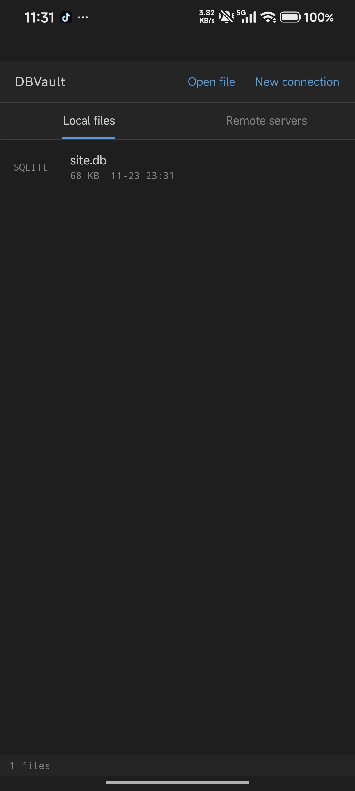
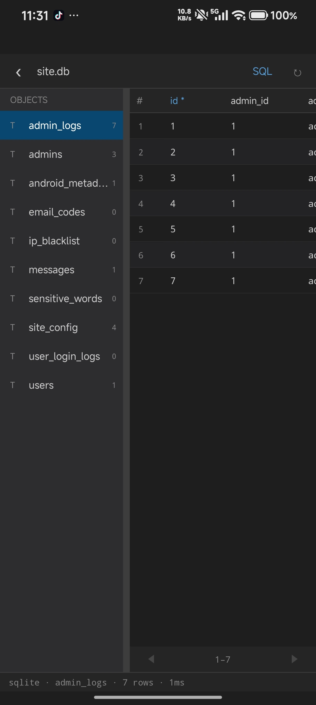
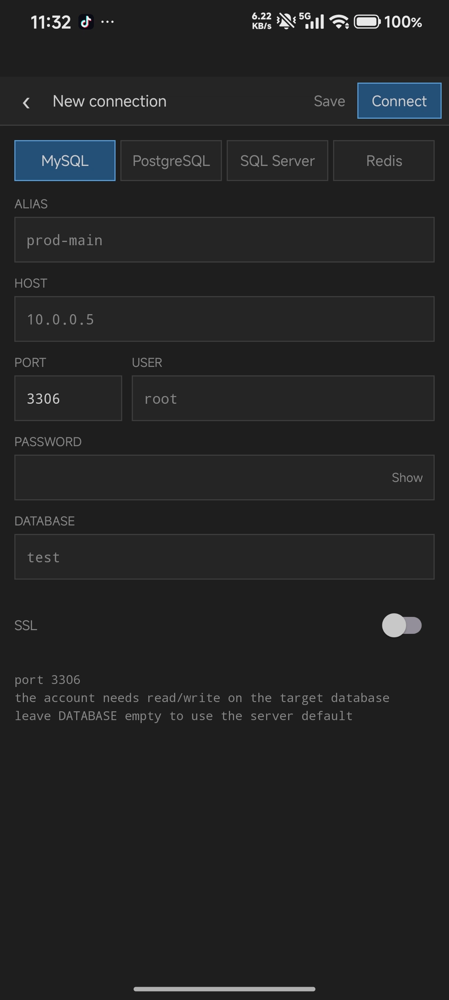

# DBVault

English | [中文](README.md)

A database workbench for Android. MIT licensed.

Two builds: `zh` is Chinese-only, `en` is English-only. Whichever you install is the language you get, regardless of the system locale. Object tree on the left, data grid on the right, edits are written straight back.
Works with local database files and with live servers: the app opens its own TCP connection, no relay service in between.

- Version 1.0.0
- Size 4.0 MB
- Android 8.0 (API 26) and up, targetSdk 33
- Package: `com.dbvault.app` (zh), `com.dbvault.app.en` (en) - both can be installed side by side

---

## 1. Workspace

```
+----------------------------------------------+
| <  site.db                       [SQL] [R]   |
+---------------+---------------+--------------+
| OBJECTS       | # | id * | admin_id | action |
| T admin_logs 7| 1 | 1    | 1        | login  |
| T admins     3| 2 | 2    | 1        | login  |
| T site_config4| 3 | 3    | 2        | logout |
+---------------+---------------+--------------+
|              <   1-7   >                     |
| sqlite - admin_logs - 7 rows - 0ms           |
+----------------------------------------------+
```

- Drag the divider to resize the sidebar; the width is remembered, a tap resets it
- Header and data scroll horizontally in sync, wide tables stay aligned
- 50 rows per page, tap a cell to edit, Enter commits
- Dark monospace UI, palette `#1E1E1E` / `#2D2D30` / `#569CD6`

### Screenshots

#### Home



Recent files plus the local / remote tabs, one tap into the workspace.

#### Browse



Object tree with row counts on the left, frozen header on the right, `id *` marks the primary key, the status line shows engine, table, rows and time.

#### New connection



Four engines side by side, the port follows the selected type, the password is encrypted with the Keystore before it is stored.

The raw shots live in `docs/`, three `zh-*` and three `en-*`.

## 2. Which build to install

| File | UI language | Package | Note |
|---|---|---|---|
| `DBVault-1.0.0-zh.apk` | Chinese | `com.dbvault.app` | the default pick |
| `DBVault-1.0.0-en.apk` | English | `com.dbvault.app.en` | installs alongside the Chinese one |

Both APKs ship inside the source archive, sitting at its root.

## 3. Supported engines

Local files:

| Format | Extensions | Read/write | Backend |
|---|---|---|---|
| SQLite | `.db` `.sqlite` `.sqlite3` `.db3` | both | platform SQLite, WAL checkpoint before sync back |
| Access | `.mdb` `.accdb` | both | Jackcess 3.0.1 |
| dBase | `.dbf` | both | byte-offset record I/O, GBK |
| CSV / TSV | `.csv` `.tsv` | both | RFC 4180, whole table rewritten |

Files are mirrored into app storage, edited, then written back to the original location. Tables without a primary key fall back to whole-row matching, confirmed before commit.

Live servers:

| Type | Port | Driver | Notes |
|---|---|---|---|
| MySQL / MariaDB | 3306 | mariadb-java-client 2.7.12 | SQL console, catalog based |
| PostgreSQL | 5432 | postgresql 42.7.3 | schema defaults to public |
| SQL Server | 1433 | mssql-jdbc 12.6.1 | `[identifier]`, `TOP` / `OFFSET FETCH` paging |
| Redis | 6379 | hand-written RESP | `keys` virtual table + command console |

Connection fields: host/IP, port, user, password, database, schema, SSL.
Credentials are encrypted with an AES-GCM key held in the Android Keystore; nothing plaintext touches disk.

## 4. Build

```bash
export JAVA_HOME=/path/to/jdk17      # 17, with jlink present
export ANDROID_HOME=/path/to/sdk     # platform 33 + build-tools 33.0.2
./gradlew assembleRelease
```

Driver jars live in `app/libs` and are picked up via `fileTree`; no network resolution needed.
Signing uses `app/dbvault-release.jks` (password `dbvault2026`), for testing only — replace it for real releases.

One Robolectric test renders the start screen to PNG to check the layout (needs at least 4 GB free memory):

```bash
./gradlew testReleaseUnitTest --tests com.dbvault.app.ScreenshotTest
```

## 5. Known limits

- Paging uses `LIMIT/OFFSET`; very large tables page slowly
- Access handles Jet tables only — no encrypted databases, no linked tables
- The SQL Server driver touches a few JRE classes and may fail on some ROMs
- No SSH tunnel, no custom SSL certificates
- BLOBs are shown as a byte count, no export
- MongoDB and Oracle are not implemented

## 6. License

MIT, see [LICENSE](LICENSE).
