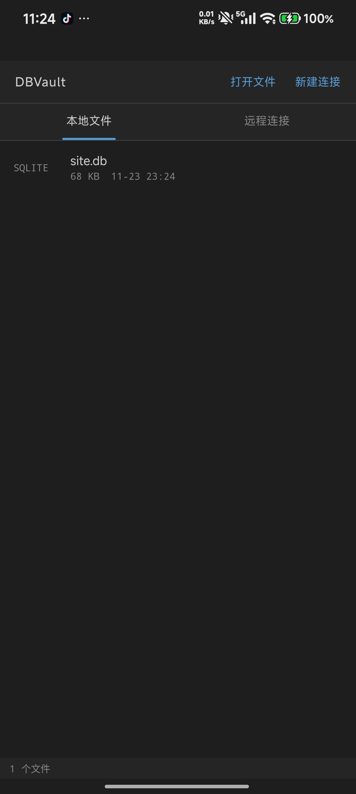
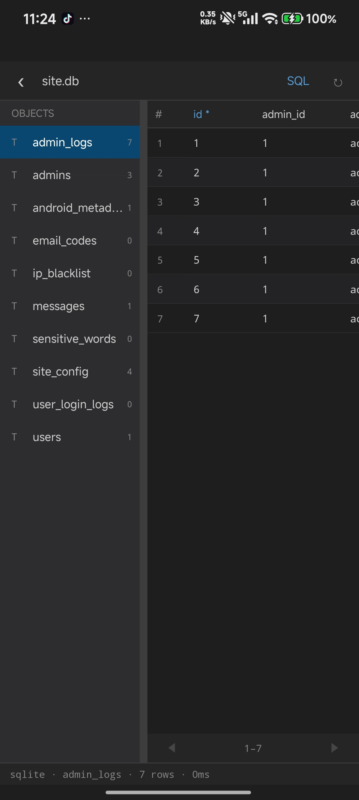
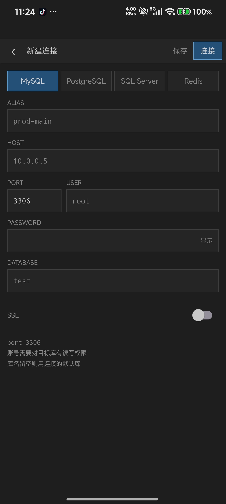

# 库钥 · DBVault

[English](README.en.md) | 中文

安卓上的数据库工作台，MIT 开源。

中英分成两个安装包：`zh` 纯中文、`en` 纯英文，装哪个就固定哪种界面，不看系统语言。左侧对象树、右侧数据网格，改完直接写回。
支持本机库文件，也支持直连线上库：App 自己跟服务器建 TCP 连接，不走中转。

- 版本 1.0.0
- 体积 4.0 MB
- 最低 Android 8.0（API 26），targetSdk 33
- 包名：`com.dbvault.app`（zh）、`com.dbvault.app.en`（en），两个可以同时装

---

## 1. 界面

```
┌──────────────────────────────────────────────┐
│ ‹  site.db                        [SQL] [↻]  │
├───────────────┬──────────────────────────────┤
│ OBJECTS       │ # │ id * │ admin_id │ action │
│ T admin_logs 7│ 1 │ 1    │ 1        │ login  │
│ T admins     3│ 2 │ 2    │ 1        │ login  │
│ T site_config4│ 3 │ 3    │ 2        │ logout │
├───────────────┴──────────────────────────────┤
│              ◀   1–7   ▶                     │
│ sqlite · admin_logs · 7 rows · 0ms           │
└──────────────────────────────────────────────┘
```

- 侧栏宽度可拖，松手记住，单击分隔条复位
- 表头与数据横向双向联动，宽表不会错位
- 每页 50 行，点单元格直接改，回车提交
- 深色等宽界面，配色 `#1E1E1E` / `#2D2D30` / `#569CD6`

### 实机截图

#### 首页



最近打开的文件、本地文件与远程连接两个页签都在这一屏，点一下直接进。

#### 浏览



左侧对象树带行数，右侧固定表头，`id *` 标出主键，底部一行是引擎、表名、行数、耗时。

#### 新建连接



四种引擎平铺，切类型端口跟着走，密码用 Keystore 加密存在本地。

截图原图在 `docs/` 下，`zh-*` 与 `en-*` 各三张。

## 2. 装哪个

| 文件 | 界面语言 | 包名 | 说明 |
|---|---|---|---|
| `DBVault-1.0.0-zh.apk` | 中文 | `com.dbvault.app` | 默认装这个 |
| `DBVault-1.0.0-en.apk` | English | `com.dbvault.app.en` | 可与中文版共存 |

两个包都随源码压缩包附了一份，压缩包根目录下就是这两个 APK。

## 3. 支持的库

本地文件：

| 格式 | 扩展名 | 读写 | 实现 |
|---|---|---|---|
| SQLite | `.db` `.sqlite` `.sqlite3` `.db3` | 读写 | 系统 SQLite，写回前做 WAL checkpoint |
| Access | `.mdb` `.accdb` | 读写 | Jackcess 3.0.1 |
| dBase | `.dbf` | 读写 | 按记录偏移读写，GBK |
| CSV / TSV | `.csv` `.tsv` | 读写 | RFC 4180，整表重写 |

文件先镜像到应用私有目录，改完写回原位置。没有主键的表按整行匹配，提交前确认一次。

线上库：

| 类型 | 端口 | 驱动 | 说明 |
|---|---|---|---|
| MySQL / MariaDB | 3306 | mariadb-java-client 2.7.12 | 可跑 SQL，catalog 语义 |
| PostgreSQL | 5432 | postgresql 42.7.3 | schema 默认 public |
| SQL Server | 1433 | mssql-jdbc 12.6.1 | `[标识符]`，`TOP` / `OFFSET FETCH` 分页 |
| Redis | 6379 | 自写 RESP | `keys` 虚拟表 + 命令台 |

连接参数：主机/IP、端口、用户名、密码、库名、schema、SSL。
凭据用 Android Keystore 里的 AES-GCM 密钥加密后落盘，明文不写磁盘。

## 4. 构建

```bash
export JAVA_HOME=/path/to/jdk17      # 需要 17，且带 jlink
export ANDROID_HOME=/path/to/sdk     # platform 33 + build-tools 33.0.2
./gradlew assembleRelease
```

驱动 jar 都在 `app/libs`，走 `fileTree`，不需要联网解析。
签名文件是 `app/dbvault-release.jks`，口令 `dbvault2026`，仅供测试，正式发布请换掉。

有个 Robolectric 单测会把首页渲染成 PNG 校验布局（至少要 4GB 可用内存）：

```bash
./gradlew testReleaseUnitTest --tests com.dbvault.app.ScreenshotTest
```

## 5. 已知限制

- 大表用 `LIMIT/OFFSET` 分页，百万行以上翻页慢
- Access 只处理 Jet 引擎的表，加密库与链接表不支持
- SQL Server 驱动依赖部分 JRE 类，个别 ROM 上可能加载失败
- 没有 SSH 隧道，没有自定义 SSL 证书
- BLOB 只显示字节长度，不支持导出
- MongoDB、Oracle 未实现

## 6. 许可

MIT，见 [LICENSE](LICENSE)。
